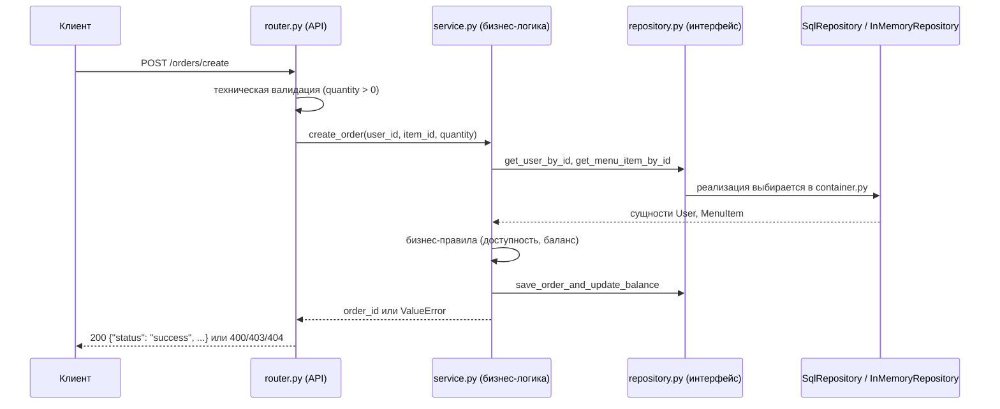

# Сириус.Еда — рефакторинг в Clean Architecture

Все четыре модуля (`users`, `menu`, `orders`, `delivery`) разделены на три слоя:
`router.py`, `service.py`, `repository.py`. Внешнее поведение API не изменилось.

## Что изменилось

| Было (MVP) | Стало |
| --- | --- |
| HTTP, бизнес-правила и SQL в одной функции `router.py` | Три файла на модуль: `router.py` -> `service.py` -> `repository.py` |
| Бизнес-логика работает с ORM-моделями | Бизнес-логика работает с сущностями `app/entities.py` (обычные dataclass) |
| `HTTPException` внутри бизнес-проверок | Сервис бросает `ValueError` / `NotFoundError` / `ForbiddenError`, роутер переводит их в 400 / 404 / 403 |
| Репозитория нет | Абстрактный интерфейс (ABC) в `repository.py` и две реализации: `Sql...` (PostgreSQL) и `InMemory...` |
| Сборка слоёв в каждом обработчике | Одно место сборки: `app/container.py` (composition root) |

Правило зависимостей: `service.py` не импортирует `fastapi` и `sqlalchemy`
(это проверяет тест `tests/test_architecture.py`).

## Структура

```text
app/
├── main.py            # точка входа
├── container.py       # сборка: репозиторий -> сервис (выбор реализации)
├── database.py        # подключение к PostgreSQL
├── models.py          # ORM-модели (SQLAlchemy)
├── entities.py        # сущности предметной области (dataclass)
├── mappers.py         # ORM-модель -> сущность
├── memory_store.py    # хранилище для in-memory репозиториев
├── exceptions.py      # доменные исключения (без fastapi)
├── http_errors.py     # исключение -> HTTP-статус
├── schemas.py         # Pydantic-схемы
└── modules/
    ├── users/     {router.py, service.py, repository.py}
    ├── menu/      {router.py, service.py, repository.py}
    ├── orders/    {router.py, service.py, repository.py}
    └── delivery/  {router.py, service.py, repository.py}
tests/                 # unit-тесты (без СУБД) и API-тест на in-memory
```

## Путь запроса через слои



Текстовый вариант:

```text
HTTP -> router.py -> service.py -> repository.py (ABC) -> SQL / in-memory
        (Круг 4)     (Круги 1-2)    (Круг 3)
```

## Запуск

```bash
python3 -m venv .venv
source .venv/bin/activate
pip install -r requirements.txt
sudo docker-compose up -d db redis
uvicorn app.main:app --reload
```

Swagger: http://127.0.0.1:8000/docs (SQL-логи выводятся в терминал;
отключить: `SQL_ECHO=0`).

## Тесты

```bash
pytest -v
```

Тесты не требуют PostgreSQL: сервисы проверяются на `InMemory...` репозиториях.

## Замена реализации репозитория

Переключатель находится только в `app/container.py`, файлы `service.py` и
`router.py` не меняются:

```bash
REPO_BACKEND=memory uvicorn app.main:app --reload   # без PostgreSQL, данные в памяти
REPO_BACKEND=postgres uvicorn app.main:app --reload # по умолчанию
```

## Примечания

- Технические проверки (`quantity > 0`, `amount > 0`, формат телефона, цена и длина
  названия блюда) выполняются в роутере, бизнес-правила — в сервисе.
- Заказ создаётся со статусом `processing`, а курьера можно назначить только на
  заказ со статусом `paid` (так было в исходном MVP). Эндпоинта оплаты в проекте нет,
  поэтому для ручной проверки `delivery` статус заказа меняют в БД:
  `UPDATE orders SET status = 'paid' WHERE id = 1;`
